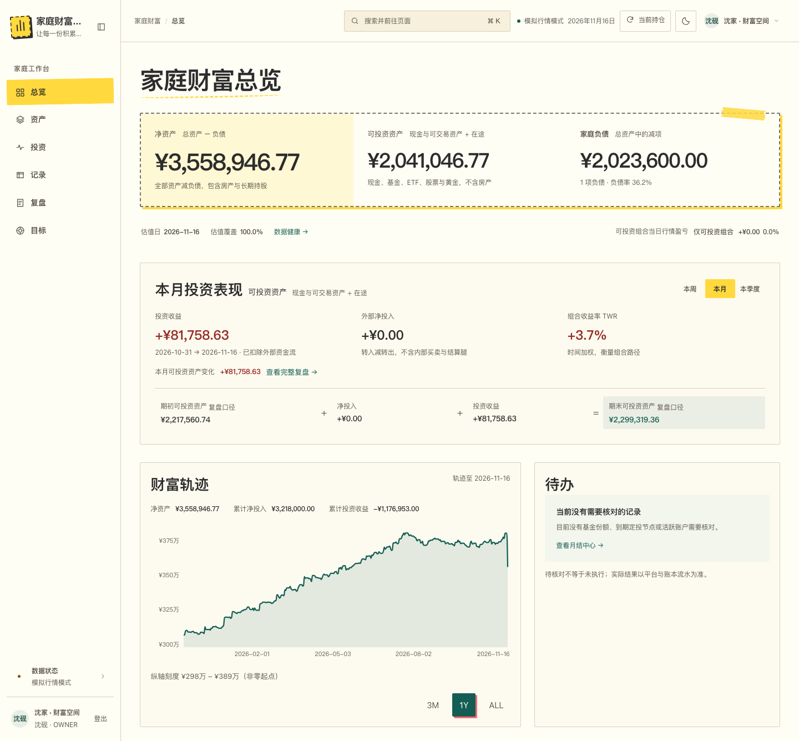

# Family Wealth OS · 家庭财富终端

可自托管的家庭财富工作台。以交易流水为账本，追踪家庭净资产、投资表现与退休目标。

[快速开始](#快速开始) · [项目文档](context/README.md) · [部署指南](DEPLOY-TENCENT-CLOUD.md)



- **看清家底**：汇总多账户、多币种的资产与负债，分别查看家庭净资产和可自由投资资产。持仓与成本可追溯到交易流水。
- **复盘投资**：查看市场行情、基金净值和收益日历，按自定义分组拆解收益贡献，用 TWR 和 XIRR 观察组合表现。
- **管理记录与目标**：预检并导入 CSV 流水，核对定投、完成月结，用 FIRE 情景测算检视退休目标。支持家庭协作、审计与备份。

## 快速开始

使用 Node.js 22，默认使用 SQLite。以下命令适用于全新工作区。`db:init` 会清空现有业务数据并创建 Owner 账号，已有数据时跳过这一步。

```bash
npm ci
touch prisma/dev.db
npm run db:migrate
npm run db:init
npm run dev
```

打开 [localhost:3000](http://localhost:3000)，登录后创建账户、登记资产，再录入或导入首笔流水。

## 部署与开发

<details>
<summary>Docker 部署与数据备份</summary>

```bash
docker compose up -d --build
docker compose exec app npm run db:init  # 仅在首次初始化空白工作区时执行
```

SQLite 数据保存在 `fwos-data` 卷。可在「设置 → 数据」中备份，或运行 `npm run db:backup`，再将备份文件复制到容器外留存。

[部署与 HTTPS](DEPLOY-TENCENT-CLOUD.md) · [PostgreSQL 和行级安全](docs/adr/007-local-first-database-strategy.md) · [环境变量示例](.env.example)

</details>

<details>
<summary>开发命令与项目资料</summary>

当前版本为 `0.1.0`，使用 Next.js 15、React 19、TypeScript 和 Prisma。

```bash
npm test          # 单元测试
npm run build     # 生产构建和类型检查
npm run test:e2e  # 独立数据库与 Playwright 测试
```

[当前状态](context/CURRENT_STATE.md) · [代码地图](context/CODEBASE_MAP.md) · [数据口径](context/DOMAIN_MODEL.md) · [界面规范](design.md) · [移动端对接](docs/mobile-app/APP_PLAN.md)

</details>
