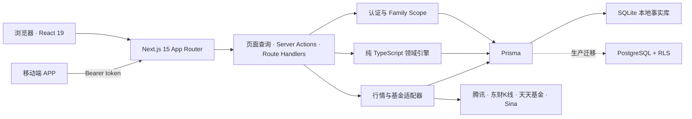

# 系统架构

## 运行时概览

## 认证与会话

- **账号**：`User`（email + scrypt 密码哈希）；**家庭关系**：`Member`（User 可在多个家庭各有角色 OWNER/ADMIN/MEMBER/VIEWER）。
- **双通道会话**：`Session` 表同时服务网页（httpOnly cookie `fw_session`）与移动端 APP（`Authorization: Bearer`）；`getSession()` 认两者。
- 登录/注册/登出/改密在 `src/app/api/auth/*`、`src/app/api/account/*`；家庭/成员/邀请在 `src/app/api/family/*`。
- 未登录访问页面 → middleware 重定向 `/login`；登录但无家庭 → `/onboarding` 引导。
- 只读 API 鉴权：用户会话优先，回落全局 `PORTFOLIO_API_KEY`。

## 分层与依赖方向

1. `src/app/`：路由、服务端页面和 HTTP 边界。页面通过查询装配函数取数，写操作走 Server Actions 或 Route Handlers。
2. `src/components/`：React UI 和表单。客户端组件不直接访问数据库。
3. `src/lib/queries.ts`：将会话、数据库、领域引擎、行情和投影装配成页面 View Model。
4. `src/lib/actions.ts`：输入校验、权限、事务写入、审计、快照刷新和路径 revalidation。
5. `src/lib/engine/`：与 Prisma 解耦的确定性纯函数。允许依赖共享 engine types，不应依赖 React、Next 或数据库。
6. `src/lib/market/`：外部行情、符号解析、基金估值和 `PriceBar` 持久化。
7. `src/lib/auth/`：密码哈希、会话工具；`src/lib/backup.ts` 在线快照备份。
8. `prisma/`：SQLite 事实 schema、PostgreSQL 镜像 schema、SQLite 迁移和 PostgreSQL RLS。

正常依赖方向是 `app/components → queries/actions → engine/market → Prisma/external services`。领域引擎不能反向依赖页面、Prisma 或网络。

## 核心数据流

### 写入流水

表单/API 输入 → Zod → `requireWrite` → 家庭/账户/资产/时间线校验 → Prisma 事务 → 可选现金结算腿 → 审计链 → 重建快照 → revalidate 页面。

### 读取组合

当前成员会话 → `FamilyCtx` → family-scoped 查询 → 过滤已冲正流水 → `foldTransactions` → 行情/手动值/成本估值 → 聚合净资产、可投资资产和风险指标 → 服务端页面。

### 刷新行情

日常链路先由账本重放识别当前持仓，再按美股收盘、境内收盘、基金净值三个时段分别调用真实 provider，幂等更新 `PriceBar` / `RateBar`，并从最早受影响行情日起增量重建快照。完整维护才扫描拆分、覆盖已清仓历史资产、补历史汇率、清理模拟 K 线并全量重建；服务器通过 `deploy/server-refresh.sh` 加锁执行三个每日增量任务与一个周末完整任务。

## 数据库策略

- 开发/单家庭默认 SQLite：`prisma/schema.prisma`，数据库为 `prisma/dev.db`。
- 正式多家庭可使用 `prisma/schema.postgres.prisma` 生成独立 PG Client，并应用 `prisma/rls.sql`。
- SQLite 迁移只新增目录，不能改写已应用 migration。
- `PriceBar`、`FundEstimate`、`FundCalibration`、`User`、`Session`、`Invite` 是全局数据（无 familyId）；其余主要业务表是家庭作用域。

## 构建隔离

- 开发：`.next-dev`，默认端口 3000。
- 生产：`.next`，默认端口 3000。
- E2E：`.next-e2e`，专用 SQLite 数据库，端口 3200，`MARKET_PROVIDER=simulated`。

不得让两个进程共享同一个 dist 目录。
